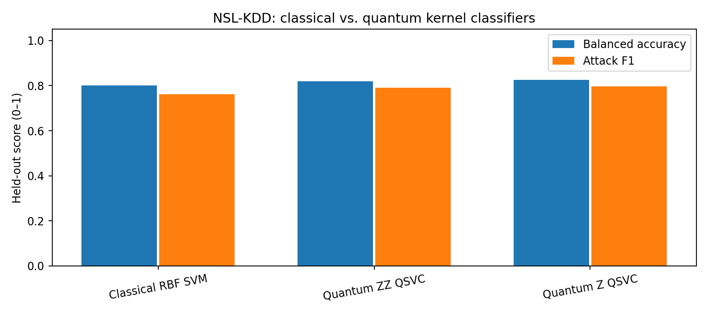
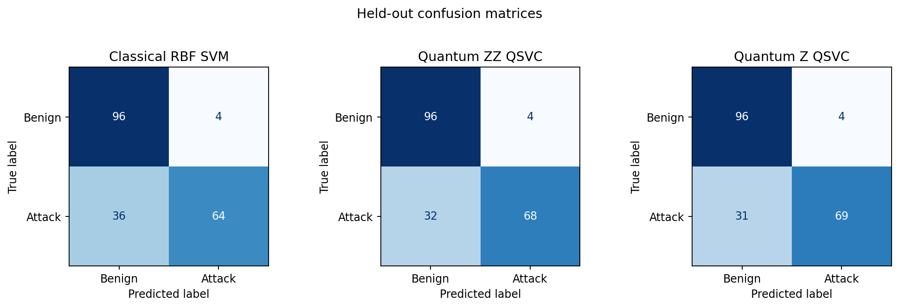
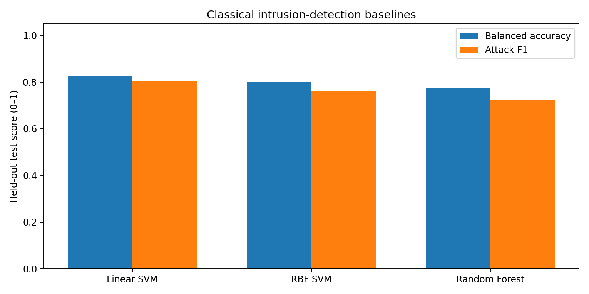
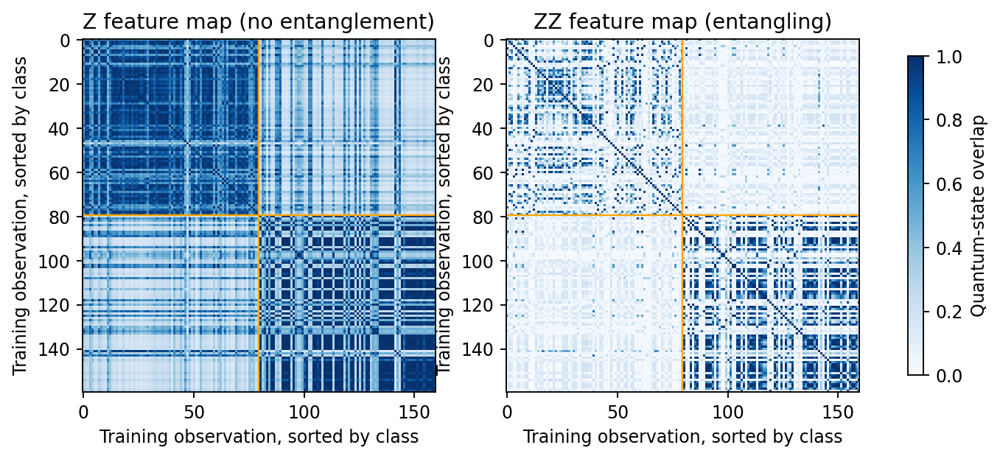
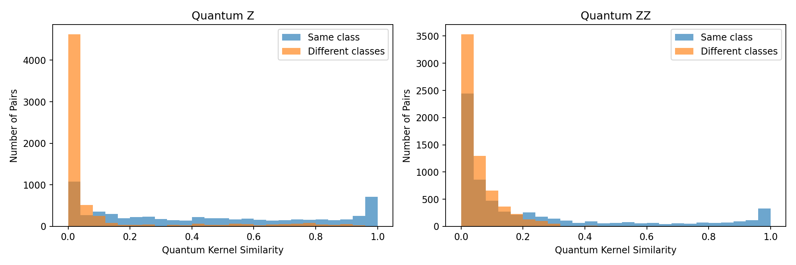

# QuantumShield: Quantum Kernel-Based Network Intrusion Detection

**Interstate Quantum Hackathon for Beginners — Fall 2026 | Quantum Machine Learning (QML) Track**

**Team name:** QuantumShield  
**Team members:** Herrick Vasck and Carter Ishmael  
**Affiliation / department / career level:** Middle Tennessee State University (MTSU); Computer Science / Physics; undergraduate students  
**Submission category:** Rising-star 

## Executive summary

- Developed **QuantumShield**, an exploratory binary network-intrusion classifier using quantum-kernel support vector classification (QSVC) on a **four-qubit statevector simulator**.
- Encoded four numerical NSL-KDD traffic features with **non-entangling Z** and **entangling ZZ** quantum feature maps, and compared both against classical support vector machines.
- Evaluated **160 labeled training observations** and **200 separate test observations**, with 50% benign and 50% attack records in each subset.
- Conducted exploratory experiments varying sample counts and circuit repetitions, investigated quantum-kernel similarity patterns, and tuned each principal model independently using **three-fold cross-validation on training data**.
- In the independently tuned comparison, the **classical RBF SVM achieved 80.5% test accuracy**, compared with **78.0% for Quantum Z QSVC** and **76.0% for Quantum ZZ QSVC**. The quantum Z model yielded the lowest false-positive rate (2%).
- Added independent classical baselines: **Linear SVM (82.5%)**, **fixed-parameter RBF SVM (80.0%)**, and **Random Forest (77.5%)** test accuracy. These are additional baselines with fixed/default settings, not identically tuned alternatives.
- Found that **feature-map design and model-selection choices materially affected results**, while circuit entanglement did not consistently improve classification. **No quantum computational advantage is claimed.**

## 1. Motivation and research questions

Network intrusion detection is a binary classification problem: label network traffic as benign or malicious using properties of each connection. Quantum kernel learning offers another way to represent similarities among data points. Rather than replacing the classical SVM optimizer, a parameterized quantum circuit maps each connection to a quantum state; similarities between quantum states define a kernel used by the SVM.

We investigated:

1. Can Z and ZZ quantum feature maps classify network traffic competitively with classical machine learning models on a small, controlled benchmark?
2. Does an entangling ZZ feature map improve discrimination relative to a non-entangling Z feature map?
3. How do the observed results change with training/test sample counts, feature-map repetitions, and independently selected hyperparameters?
4. What do quantum kernel matrices reveal about within-class and between-class similarities?

This is an **educational, exploratory experiment**, not a real-time intrusion-detection deployment.

## 2. Data and preprocessing

**Dataset.** NSL-KDD from the public [Jehuty4949/NSL_KDD mirror](https://github.com/Jehuty4949/NSL_KDD). The source training file is `KDDTrain+_20Percent.txt`; the separate test source is `KDDTest+.txt`. The `normal` label is mapped to benign (`0`); all other attack labels are mapped to attack (`1`).

**Primary sample.** A reproducible stratified/balanced sample of **80 benign and 80 attack training records** (160 total) and **100 benign and 100 attack test records** (200 total). Training sampling uses seed `42`; test sampling uses seed `43`. The files are distinct data sources.

**Features.** We used four numerical traffic attributes, one input dimension per qubit:

- `src_bytes`: bytes sent from source to destination;
- `dst_bytes`: bytes sent from destination to source;
- `count`: number of recent connections to the same destination host;
- `srv_serror_rate`: rate of SYN errors for the corresponding service.

**Transforms.** The first three nonnegative, skewed features were transformed using `log1p`. Inputs were then scaled to the interval **[0, π]** using `MinMaxScaler`, fit on training observations only; out-of-range transformed test values were clipped to the encoding interval. During cross-validation, the scaler was fitted separately within each training fold, preventing fold-validation data from influencing preprocessing estimates.

## 3. Models and quantum methodology

**Classical models.** The principal classical comparison is an RBF support vector classifier; its penalty `C` and RBF width `gamma` were selected using three-fold training cross-validation. A separate companion script, `classical_baselines.py`, evaluates a fixed-parameter Linear SVM (`C=1`), fixed-parameter RBF SVM (`C=1`, `gamma='scale'`), and Random Forest (100 trees). This supplies additional classical context, but the fixed-setting models must be distinguished from the independently tuned comparison.

**Quantum models.** Two quantum kernel classifiers were implemented in Qiskit Machine Learning:

- **Quantum Z QSVC:** four-qubit Z feature map without entangling feature-map interactions.
- **Quantum ZZ QSVC:** four-qubit ZZ feature map with entangling interactions between qubit states.

For observations \(x_i\) and \(x_j\), the quantum kernel is the state fidelity:

\[
K(x_i,x_j)=\left|\langle\phi(x_i)\mid\phi(x_j)\rangle\right|^2.
\]

Qiskit's `FidelityStatevectorKernel` computes these quantum-state overlaps **exactly in a classical statevector simulation**. The resulting kernel matrix is passed to a conventional SVM solver; the quantum circuit supplies the data representation, while fitting the SVM remains classical.

The principal independently tuned run uses **four qubits, two feature-map repetitions (`REPS=2`)**, and a bandwidth factor \(\lambda\) applied to the encoded inputs. This is not execution on quantum hardware.

## 4. Experimental design and model selection

We explored data size and circuit depth, then performed a more rigorous model-selection comparison. For the latter, we independently selected hyperparameters using **three-fold cross-validation restricted to training data**:

| Model | Selected hyperparameters | Mean CV balanced accuracy |
|---|---|---:|
| Classical RBF SVM | `C=10`, `gamma='scale'` | 95.04% |
| Quantum Z QSVC | `λ=1.0`, `C=10` | 95.63% |
| Quantum ZZ QSVC | `λ=0.5`, `C=1` | 95.61% |

The candidate grid included quantum \(\lambda\in\{0.25,0.50,1.0\}\), penalties \(C\in\{0.1,1,10\}\), and classical `gamma` choices `scale`, `0.1`, and `1.0`.

**Important distinction:** Cross-validation scores are training-side model-selection estimates, not held-out test scores. The test results below are lower. Because the same test subset was inspected repeatedly during exploratory work, even the later comparison should be interpreted as **exploratory**, not a pristine final generalization estimate.

## 5. Results

### 5.1 Independently tuned principal comparison

The following values are the observed results in `results/metrics.csv` for **160 training and 200 test records**, with `REPS=2`.

| Model | Accuracy | Balanced accuracy | Attack precision | Attack recall | Attack F1 | False-positive rate | Missed attacks |
|---|---:|---:|---:|---:|---:|---:|---:|
| **Classical RBF SVM (tuned)** | **80.5%** | **80.5%** | 94.2% | **65.0%** | **76.9%** | 4.0% | **35** |
| Quantum Z QSVC (tuned) | 78.0% | 78.0% | **96.7%** | 58.0% | 72.5% | **2.0%** | 42 |
| Quantum ZZ QSVC (tuned) | 76.0% | 76.0% | 91.9% | 57.0% | 70.4% | 5.0% | 43 |

The tuned classical RBF model has the highest overall accuracy and attack recall of these three models. Quantum Z generates only **two false positives among 100 benign test records**, but misses **42 of 100 attack records**. In this sample, minimizing false alarms trades off against missing more attacks.





### 5.2 Additional classical baselines

Carter Ishmael implemented the reproducible `classical_baselines.py` script using the same four features and sampling configuration. The script reports the following **fixed-parameter** results from `results/classical_baselines.csv`:

| Classical model | Accuracy | Balanced accuracy | Attack precision | Attack recall | Attack F1 | False-positive rate | Missed attacks |
|---|---:|---:|---:|---:|---:|---:|---:|
| **Linear SVM (`C=1`)** | **82.5%** | **82.5%** | 90.1% | **73.0%** | **80.7%** | 8.0% | **27** |
| RBF SVM (`C=1`, `gamma='scale'`) | 80.0% | 80.0% | 94.1% | 64.0% | 76.2% | 4.0% | 36 |
| Random Forest (100 trees) | 77.5% | 77.5% | 93.7% | 59.0% | 72.4% | 4.0% | 41 |

The Linear SVM performed best among these three additional baselines and exceeded all three models in the independently tuned primary comparison on observed test accuracy. Its higher attack recall came with the highest false-positive rate (8%). Because not all models were selected under an identical hyperparameter-search protocol, **these tables are descriptive rather than a uniform model-selection tournament**.



### 5.3 Earlier exploratory experiments

Before independent tuning, we changed the number of train/test observations and the feature-map repetition count. The following values were recorded in the preliminary experiments and preserved in `experiment_archives/`:

| Experiment | Training | Testing | Repetitions | Classical RBF accuracy | Quantum Z accuracy | Quantum ZZ accuracy |
|---|---:|---:|---:|---:|---:|---:|
| 1 — Initial baseline | 80 | 40 | 2 | 87.5% | 85.0% | 85.0% |
| 2 — Larger test sample | 80 | 200 | 2 | 84.5% | 83.5% | 82.0% |
| 3 — Larger training sample | 160 | 200 | 2 | 80.0% | **82.5%** | 82.0% |
| 4 — Shallower circuit | 160 | 200 | 1 | 80.0% | **82.5%** | **82.5%** |

In Experiments 3 and 4, one or both quantum feature maps exceeded the corresponding classical RBF baseline on accuracy. But those settings were selected differently from the later independently tuned comparison. Also, expanding the training sample caused resampling and refitting of preprocessing, so changes across experiments cannot be attributed exclusively to training-set size. The observed differences are small, and no statistical significance or general quantum advantage is established.

### 5.4 Quantum kernel similarity analysis

We visualized the state-fidelity kernel matrices and calculated average similarities between pairs of training observations. For the **current independently tuned experiment**, the CSV `results/quantum_similarity_metrics.csv` gives:

| Feature map | Mean similarity: same class | Mean similarity: different classes | Similarity gap |
|---|---:|---:|---:|
| Quantum Z | 0.4404 | 0.1023 | **0.3382** |
| Quantum ZZ | 0.2244 | 0.0586 | 0.1658 |

Both feature maps show larger average similarity for pairs sharing the same class. The Z map has the larger absolute difference between within-class and between-class similarities in this training sample. However, this statistic does not directly measure generalization, and the difference does not prove that non-entangling maps are universally better.





## 6. Interpretation

The experiments show that **data encoding and model selection are central to quantum kernel classification**. Introducing ZZ entanglement changes the quantum-state similarity structure substantially, but did **not consistently improve** intrusion-detection performance on this sample. The simpler Z feature map sometimes performed as well or better.

A second finding concerns **evaluation methodology**. Some preliminary configurations favored quantum classifiers by small margins, while the independently tuned comparison favored the classical RBF model. The highest observed scores should not be used to claim quantum superiority. In addition, the separate fixed-parameter Linear SVM baseline achieved the best observed accuracy among the reported models, illustrating how competitive straightforward classical methods can be for low-dimensional tabular data.

In practical intrusion detection, the tradeoff between **missed attacks** and **false alarms** is often more important than accuracy alone. For example, the independently tuned Quantum Z model had fewer false alarms than the tuned RBF SVM, but it detected fewer attacks. On this deliberately balanced test subset, model selection therefore depends on which type of error matters most.

## 7. Limitations and future work

- **Small, balanced sample.** The principal comparison uses only 160 training and 200 testing records, with an artificial 50/50 class balance. The results do not reflect real-world attack prevalence.
- **Legacy benchmark and limited feature set.** NSL-KDD is an older intrusion-detection dataset. Four numerical inputs omit much of the available information, and nonlinear/logarithmic preprocessing affects the observed representation.
- **Exploratory reuse of test observations.** Multiple settings were examined on the same test subset. A stronger study would preregister model selection and evaluate once on a genuinely untouched test sample, preferably across multiple random draws.
- **Simulator rather than quantum hardware.** All quantum overlaps were calculated using a classical, exact statevector simulator. This does not demonstrate quantum speedup, noise robustness, or a deployable quantum advantage.
- **Incomplete runtime accounting.** The notebook's `fit_seconds` does not include all cross-validation, kernel-computation, and inference costs; it should not be interpreted as total computational runtime.
- **Further work.** Study uncertainty across repeated splits, explore alternative feature maps and independent tuning for all baselines, evaluate imbalanced traffic, and simulate finite-shot measurements and noise.

## 8. Reproducibility and division of work

**Primary notebook:** `QuantumShield.ipynb`  
**Classical companion script:** `classical_baselines.py`  
**Dependencies:** `requirements.txt`  
**Outputs:** `results/` and `experiment_archives/`

For a local Python environment on Linux or macOS:

```bash
git clone https://github.com/HerrickVasck/QuantumShield.git
cd QuantumShield
python3 -m venv .venv
source .venv/bin/activate
python -m pip install -r requirements.txt jupyterlab
jupyter lab
```

Open `QuantumShield.ipynb`, choose the `.venv` kernel, and run all cells. The notebook installs/checks its required dependencies, downloads public source files on first use, trains the models, and saves figures and CSV files. To regenerate Carter's classical baseline results, run `python classical_baselines.py` in the same environment.

**Contributions.** Herrick Vasck developed and evaluated the quantum/classical QSVC notebook and the feature-map, circuit-depth, and kernel-similarity analyses. Carter Ishmael implemented the independent classical baseline script and contributed to the research report. Both team members contributed to the combined project and presentation preparation.

## 9. Conclusion

QuantumShield demonstrates an end-to-end quantum-kernel classification pipeline for labeled network intrusion data, using a four-qubit simulator and classical SVM learning. The investigation found that **entangling feature maps and deeper circuits did not reliably improve test classification**. It also found that **hyperparameter selection and evaluation choices can reverse apparent model rankings**. Classical baselines remained competitive, and the independently tuned RBF SVM outperformed the two quantum-kernel models in the latest comparison.

The principal contribution is therefore **a reproducible, experimentally grounded comparison of quantum feature maps on a cybersecurity task**, rather than a claim of quantum speedup or operational superiority.

## References

1. Interstate Quantum Hackathon for Beginners, Fall 2026: event launch materials and *Quantum Machine Learning with Quantum Kernels* pre-training lecture.
2. NSL-KDD public dataset mirror: https://github.com/Jehuty4949/NSL_KDD
3. Qiskit Machine Learning documentation: https://qiskit-community.github.io/qiskit-machine-learning/
4. V. Havlíček et al. (2019), *Supervised learning with quantum-enhanced feature spaces*, Nature 567, 209–212. https://doi.org/10.1038/s41586-019-0980-2
